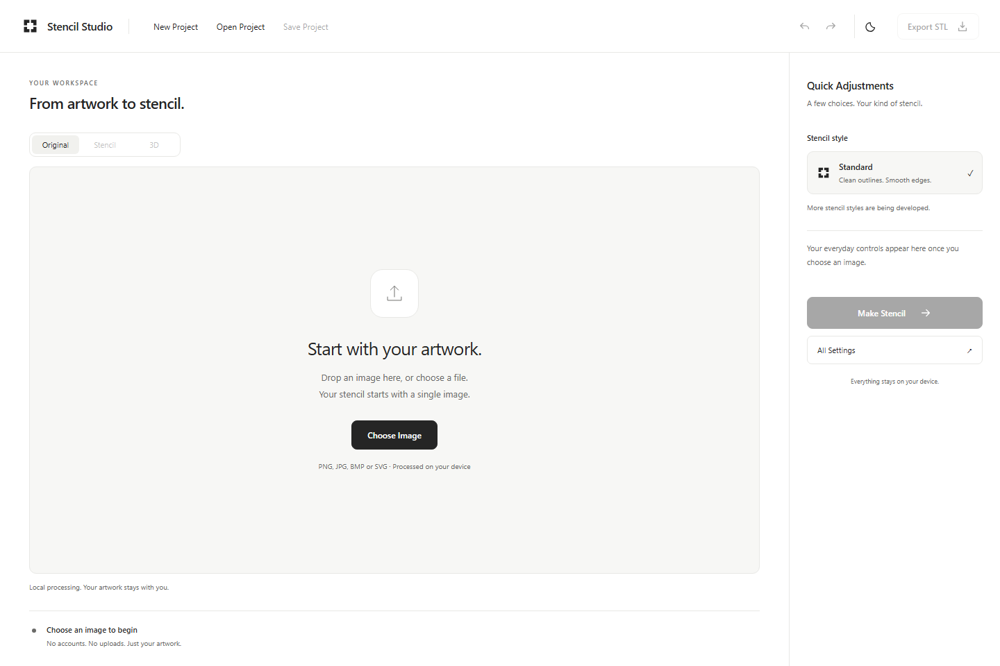
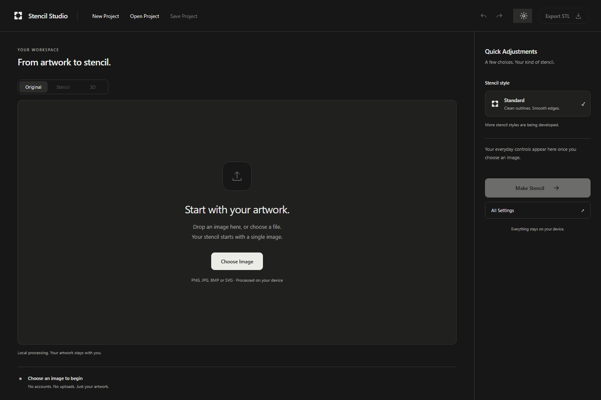
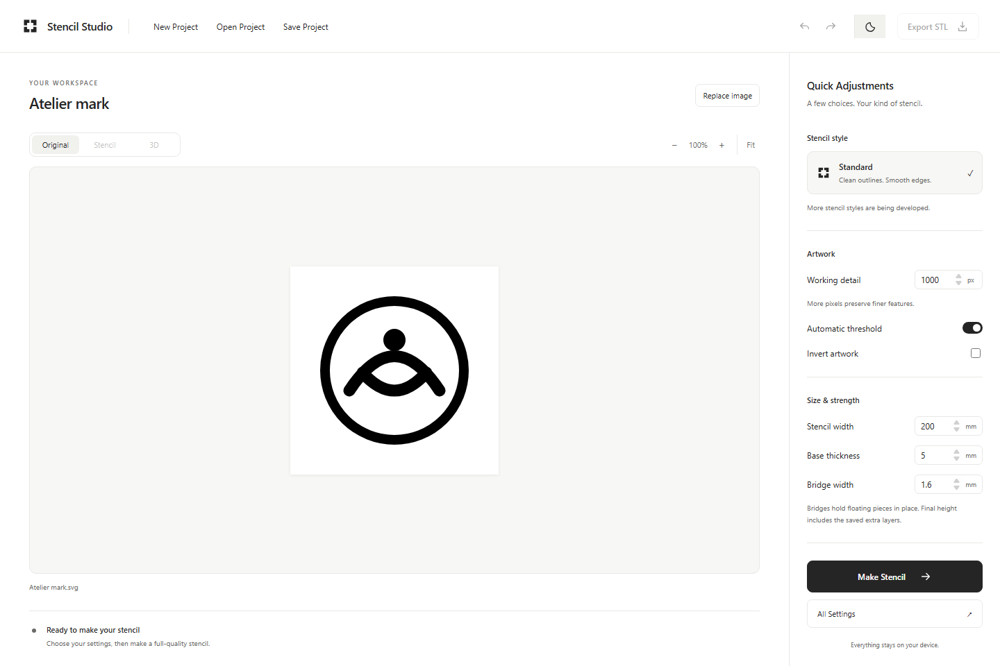
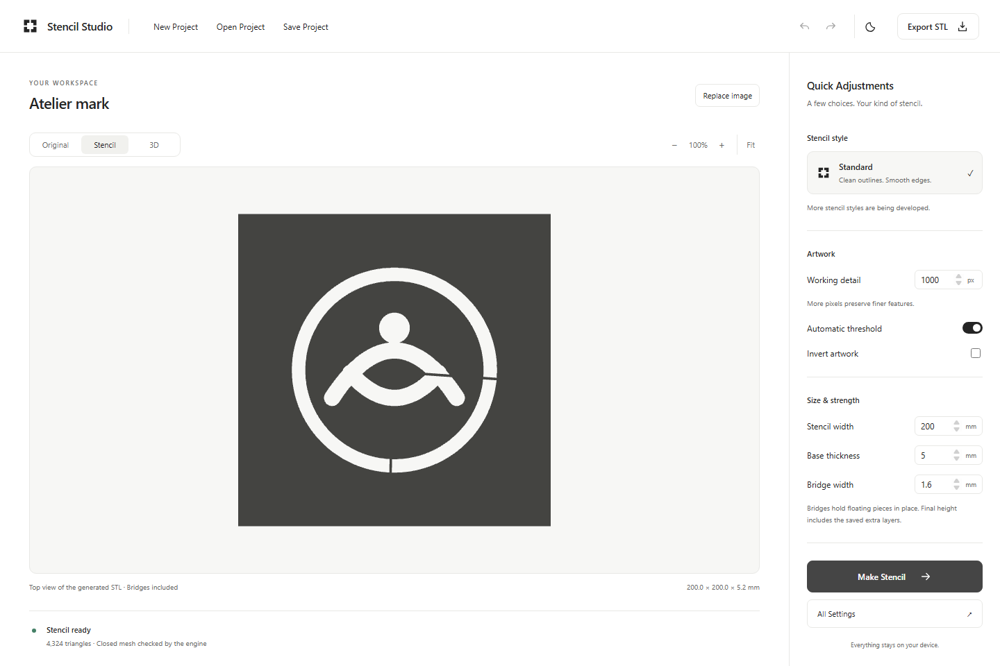
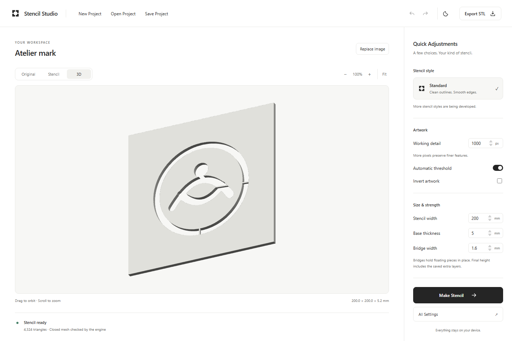
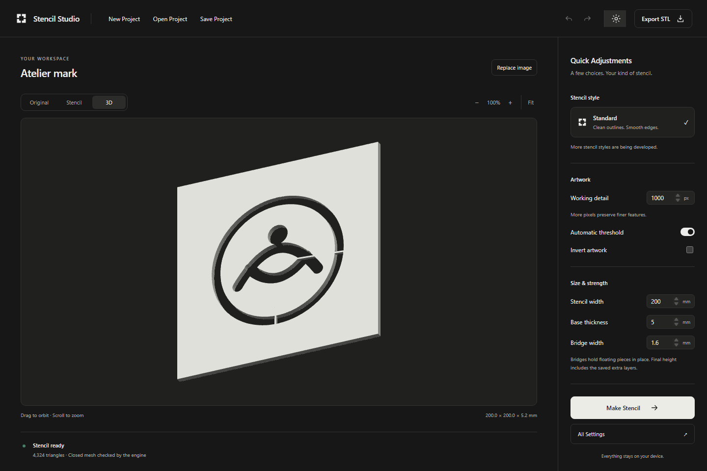
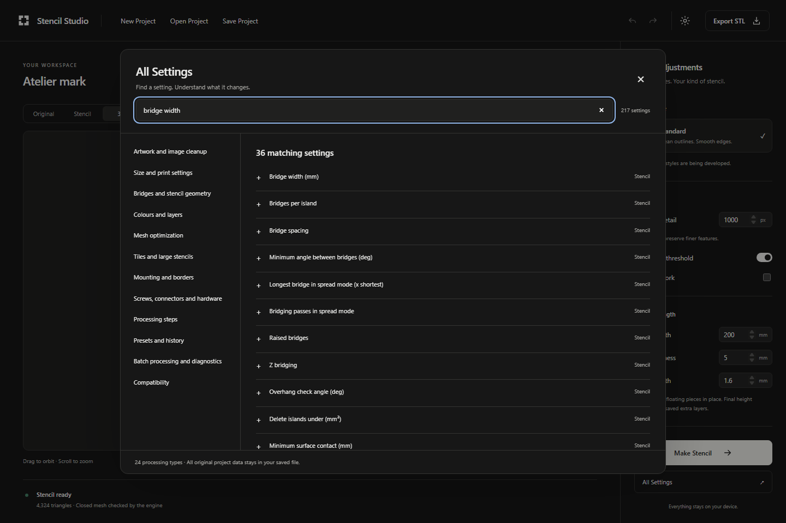

# M1 — New workspace and workflow foundation

Completed 29 October 2026 (Asia/Dubai). Based on approved M0 at `dd268e884d1722f9606c8f8d984662d8de03bed1`, preserving upstream v2.9.4's Rust/WASM engine. This milestone delivers a working application, not just a visual prototype. M2 has not started.

## What you can use now

Open or drop PNG, JPG, BMP or SVG artwork. See the original image, choose everyday settings, press **Make Stencil**, inspect the generated stencil from above or in 3D, and download its real STL. Save Project embeds the original image and processing values; opening it automatically recalculates. Reopening the same project immediately after New is covered by three repeated browser cycles and a generation-controller regression test.

The ordinary application has no processing canvas, connection wires or add-step menus. Its light/dark preference persists locally. The large preview remains the main area; everyday controls sit beside it on laptops and move below it on narrow screens. Zoom, fit, image pan and 3D orbit work. Both output views render the actual exported STL. The Stencil tab is a top projection including bridges, not an outline SVG or an image pretending to be a physical stencil.

The enabled quick settings are working resolution, automatic/manual threshold, invert, plate width, base thickness and bridge width. These are connected to real engine parameters and survive save/open. Extra saved layers can make final height greater than base thickness; the preview shows the actual dimensions. Edits make the last result stale and disable export until Make Stencil finishes again. A cancel, error or superseded generation cannot publish as the current completed result.

**Standard is the only newly offered style in M1**, using the original vector recipe and engine defaults. An imported simple raster recipe keeps its original raster behavior. Smooth Vector and Crisp Raster presets are not offered as working choices; their exact behavior belongs in M2. There is no fake contrast setting or bridge-disable switch.

All Settings provides twelve categories and search over all **24 processing types / 217 type-qualified parameters**. Each reference includes the engine default/range/choices, dependency explanation, saved instances and planned editor milestone. Executable availability rules explain inactive values without deleting them. This is a reference and architecture foundation: the specialist setting editors are not presented as functional controls yet.

## Actual screenshots

These screenshots were captured from the built application by the browser tests, using an SVG processed by the real engine.















## Project preservation

The saved JSON remains the authoritative document. Opening a project does not rebuild it from a template. Saving preserves unknown top-level values, operation ids, all parameters, positions, connections, unused branches, unreferenced embedded images and nested unknown data. JSON formatting/whitespace is not preserved byte-for-byte, but data equality and original decoded image bytes are tested.

Execution uses a separate projection. The historical `complexity` name becomes `remesh` only in that projection. Embedded image ids are remapped only for the running engine; original stored ids and image dictionaries stay unchanged. Both native graph-shaped files and the old editor's project format are supported. Newly saved projects keep the version 2 `graph`/`images` envelope accepted by the original CLI.

Imported advanced projects display a plain processing summary and retain their full recipe. Supported processing can be evaluated by the original engine, and individual generated solid/parts outputs can be selected for export. Unknown operations, malformed dependencies and missing artwork produce recoverable errors; Save Project still retains their original data. M1 does not convert arbitrary imports to Standard. Multi-source replacement and advanced structure editing are deliberately unavailable until their scoped editors exist.

The preservation tests use the original complex mounting fixture, add an unknown operation and extra branch, unknown nested settings, positions, image metadata and an unused embedded asset, then assert deep equality after save/open and a known-value edit. Separate tests cover native graph imports, migration aliases and execution-only image remapping. No node canvas is needed for these round trips.

## Architecture delivered

| Component | Responsibility |
|---|---|
| `studio/project.ts` | Lossless `ProjectDocument`, native/legacy execution projection (`compileRecipe`), exact-chain recipe recognition, original standard recipe compiler, 100-command undo/redo and byte encoding |
| `studio/registry.ts` | Live engine schema as authority, complete audit routing, search, per-instance settings, numeric/choice validation and conditional availability with workflow context |
| `studio/runController.ts` | Independent generation epochs for open/new/edit, cancellation, late-result rejection, recoverable errors and explicit draft/full/completed state |
| `studio/artifacts.ts` | Artifact ownership outside engine blob-cache lifetimes, output availability, readiness findings, measured dimensions and structural/degenerate-triangle checks without repairing output |
| `studio/session.ts` | Project commands, embedded assets, image restoration, local autosave, open/recalculate, safe file export and worker integration |
| `studio/StudioApp.tsx`, `MeshPreview.tsx`, `Settings.tsx`, `studio.css` | Customer workspace, real STL projections/orbit, everyday controls, themes and settings reference |
| `studio/StudioBoundary.tsx` | Recovery screen that can download the complete embedded-image autosave |

The original core geometry, graph algorithms, cache and worker execution are retained. The only shared transport addition is explicit image loading/restart and settlement of pending requests when a worker errors. The old editor and its support components remain available to regression tests through a separate entry.

## What remains for later milestones

| Planned scope | M1 status |
|---|---|
| Smooth Vector / Crisp Raster; refined detail/style presets | M2; no fake style choices |
| Advanced crop/cleanup, complete size/bridge/trace controls and reusable presets | Searchable references; not specialist editors |
| Colour passes, tone patterns and registration | Data, instances and dependencies preserved; specialist editing pending |
| Remesh, manufacturing tiles, seam/connector editing and multi-part preview | Original processing retained; dedicated editors pending |
| Mounting, borders, screws/nuts and fit-test configuration | Preserved/reference-only; editors pending |
| Processing-step insertion/reordering, named branching and multi-source replacement | Data model supports it; customer editors pending |
| Batch/sweep job interfaces and full diagnostics | Original CLI retained; new job interface pending |
| Automatic coarse live drafts while dragging | Run/artifact model distinguishes drafts, with tests; customer workflow runs full quality on Make Stencil |
| Complete export aggregation across plate/hardware branches | Individual engine outputs selectable; no claim of an aggregate manufacturing export planner |
| Tauri and final Windows/macOS/browser distribution | Not part of M1; no new packaging commitment |

## Test outcomes and evidence

The full combined regression run passed **106 tests** with **0 failed, skipped or flaky**: all 83 original tests plus the first 23 new tests. The original canvas-dependent tests retain their assertions and run on `legacy.html` in the explicit regression build. A separate single-thread customer-flow test was then added and passed, bringing the distinct exercised suite to **107 tests**. Final production and model tests are recorded in [test-results.json](m1/test-results.json), including the earlier development failures and their corrections.

The Rust workspace was rerun unchanged: **156 passed, 0 failed, 0 ignored** (143 core, 12 CLI and 1 findings-parity integration). Both the regression build and ordinary production build pass TypeScript and Vite compilation. npm audit reports **0 vulnerabilities** at this run's date. The catalogue coverage check still passes for all 217 mapped slots.

New automated coverage includes:

- Every search key, runtime schema counts and conditional/instance routing; compilation against the original vector chain and defaults.
- Unknown data, images, positions, branches and legacy round trips; execution-copy migration/remapping; atomic source replacement and undo/redo.
- Generation epochs, identical New→Open, superseded results, cancellation, late artifact disposal, errors and refusal to export drafts/stale results.
- Actual PNG/JPG/BMP/SVG imports, drop replacement, automatic recalculation after open/reload, real engine errors and recovery.
- Original embedded-image bytes, saved quick parameters and native replay of the browser project.
- Actual worker restart with image restoration and successful unchanged-recipe recomputation.
- Forced single-thread generation without isolation headers or MT requests; local processing with non-local HTTP blocked and no external attempts observed.
- Theme persistence, modal focus return, keyboard interaction, 1280/800/390 px responsive layouts and serious/critical axe checks in both themes.
- No canvas in the normal UI, both actual STL views and file downloads.

The browser-generated vector STL and the original native CLI replay have the same **896 canonical triangles** (compared at 0.0001 mm), bounds **120 × 94 × 3.2 mm**, and enclosed volume. An independent Python validator additionally finds one connected component, every edge shared twice with consistent winding, no degenerate faces and valid binary STL structure in both. [Geometry evidence](m1/artifact-validation.json), [engine equivalence](m1/engine-equivalence.json).

An ordinary production build is checked to contain neither `legacy.html`, `regression-api.html`, legacy editor chunks nor a reference to ReactFlow UI CSS in its main JavaScript. Developer harnesses are build-time opt-in, not a customer mode or hidden navigation link. The CI workflow now builds/runs the regression harness, then rebuilds the customer-only bundle before embedding or publishing it.

## Failures, limits and known issues

Early development checks caught missing modal focus restoration and a disabled export element losing its accessible link role. Both were corrected; the tests pass. Node 26 required a JSON import attribute in the registry's test imports; that is fixed. No failing or skipped feature test is being hidden.

The M0 geometry defects (zero-area triangles in some raster/calibration outputs), ineffective direct CLI seam-angle flag, output aggregation limitation and incomplete shipping notices remain separate tracked issues. M1 does not repair geometry or claim those defects resolved. The new STL inspector can report degenerate triangles without changing the engine's bytes. The original geometry checks still have practical limits; a ready verdict is not a physical printer fit test.

Specialist editing is intentionally unfinished. Draft state is modeled but live coarse draft generation is not enabled in the new UI. Edits require Make Stencil for a fresh full result; reopening automatically runs. New files remain CLI-compatible; preserving the old editor as a harness does not mean every new native-shaped project can be edited in that old browser UI.

Tests ran locally on Windows x64 with Rust 1.99, Node 26.3, npm 11.12.1, Chromium 156 and the existing ST/MT WASM builds. macOS, Safari/Firefox, Tauri/WebView2, fresh disconnected machine installation and signed distributables remain untested. CI configuration was updated, but remote CI status is separate from these observed local results.

## Run or continue development

From a prepared checkout with WASM built as described in INSTALL.md:

```powershell
cd web
npm ci
npm run build
npm run preview -- --port 5200
```

Open the local URL printed by Vite. Use HTTP; opening `index.html` as a plain file is not supported. The app does not send artwork to a service. To run all browser regressions, use `npm run e2e`, which first builds the developer harness. The native CLI must be built for the browser/native equivalence check. `npm run build` always restores the customer-only build afterward.

## M2 recommendation

Proceed, when instructed, with the beginner style recipes and their tested control behavior: finalize Standard/Smooth Vector/Crisp Raster against an artwork corpus, refine detail/threshold defaults and add the most useful artwork/size settings from the registry. Keep lossless import and generation tests as gates. Specialist manufacturing editors and platform packaging should keep their later milestone scope.

**M1 is complete. Stop here. M2 requires the user's next milestone instructions.**
