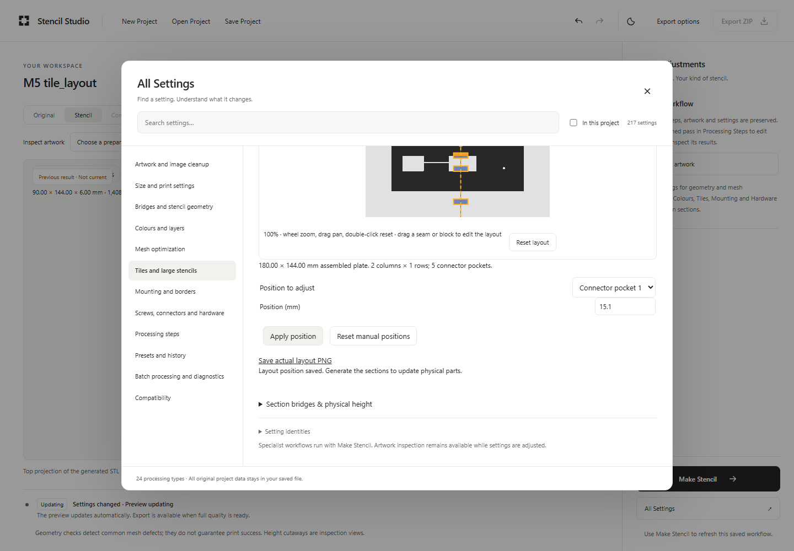
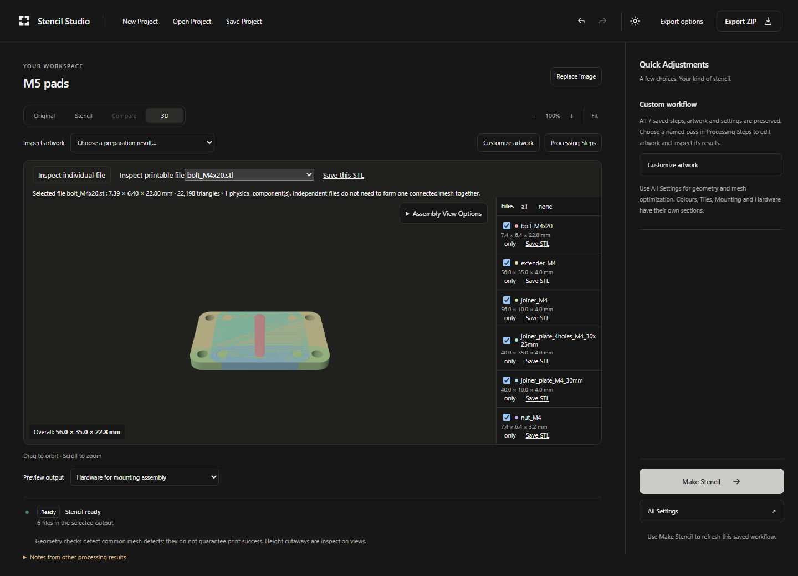
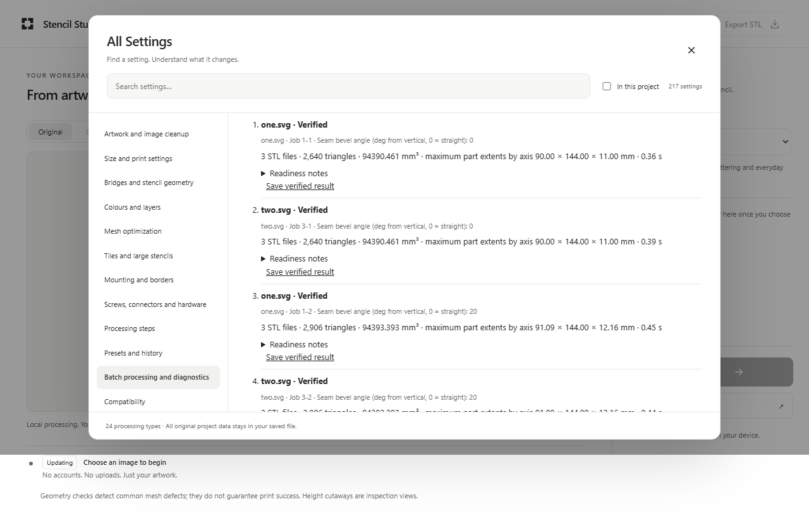

# M6 — feature parity, geometry correctness and reliability

**Functional QA Passed With Documented Limits.** The geometry, feature, project, output, production and final CI gates pass in the documented supported configurations. No known invalid required part remains in the tested complete-export workflows. Impossible, disconnected and unknown-operation negative cases remain explicit refusals. Physical printing and distribution qualification remain unverified. **M7 has not started.**

Implementation: [`a71c2e806648fb43d235f2ace3f7dca1e1dd77cf`](https://github.com/thomastt-cryoo/stenciii/commit/a71c2e806648fb43d235f2ace3f7dca1e1dd77cf). Final verification revision: [`edbe76392c21c7315119f371ae68bfbc92dc5ac6`](https://github.com/thomastt-cryoo/stenciii/commit/edbe76392c21c7315119f371ae68bfbc92dc5ac6). The later revisions change test synchronization, exact local-origin checks and documentation. Their application and engine sources are byte-identical to the implementation revision; [source-provenance.json](m6/source-provenance.json) records the canonical product-source manifest and rebuilt engine hashes. The clean customer build identifies itself as `a71c2e8`.

The accepted M5 documentation base was `cb07659c1f650a76b220fb273e09e4e349e02b8b`, with implementation `001f3d6d79167d83d366c16bf9a187da4e140fd4`. M0–M5 reports, inventories, fixtures, limits, parameter records and CI evidence were reviewed before changes. Their reviewed worktree and canonical committed hashes are retained in [reviewed-baseline.json](m6/reviewed-baseline.json).

## Findings and resulting behavior

The remaining four-facet ring/tile defect is repaired without moving vertices or weakening validation. The broader M5 discrepancies are now explained by exact surface proofs and measured spatial bounds. The expanded audit also found and repaired an STL-normal serialization error caused by float32 coordinate rounding.

The browser now provides practical offline image batches and parameter sweeps, including saved recipes, folder selection with a multiple-file fallback, isolated errors, cancellation, recoverable completed results and CSV/JSON comparisons. It uses the ordinary processing and export-validation rules. The native CLI retains its batch/sweep capabilities and gains safe collision-free job names and correctly quoted, formula-safe CSV rows.

The original application audit restored six original workflow templates, processing-step clipboard operations, bounded history navigation, explicit shared screw-fit settings, full image information and original downloads, mask overlays, project naming, diagnostics, local usage ordering and keyboard sidebar resizing. Storage failures, damaged recovery data, unknown project content, reserved imported identities and threaded-worker startup failures have explicit tested behavior. The beginner flow remains **Upload → Make Stencil → Customize → Preview → Export**, without a node canvas.

## Complete feature and parameter audit

The verified count is **24 processing types and 217 unique qualified parameter slots**. Every slot was edited through the real customer interface; numeric bounds/steps, schema labels, every allowed choice, reset, instance scope, undo/redo and saved-file reopen were checked. The actual engine executed **345 values/choices** in native, single-thread and four-thread WASM modes. Four physically impossible connector/pad settings produced matching explicit constraints in all three engines.

The bridge-off tile fixture is a separate negative export case: its two closed bodies are structurally valid but fail the stencil's required connectivity. Ordinary export, complete ZIP export and browser batch all block it; restoring tile-island bridging restores a complete export. It is not counted as a printable two-body tile. See [disconnected-guard-validation.json](m6/disconnected-guard-validation.json).

- [Full original-versus-new matrix: all 44 application rows and all 217 fields](m6/FEATURE_PARITY.md).
- [217-field schema, dependencies, settings, fixtures and executable outcomes](m6/parameter-coverage-217.json).
- [44 application capabilities, original behavior, new location and limitations](m6/feature-parity-44.json).
- [345 retained portable control projects](m6/fixtures/control-projects/) and [256 manufacturing before/after projects](m6/fixtures/manufacturing-projects/).

Aliases, duplicated operation instances and execution-only CLI flags do not inflate the count. The original inventory includes release-platform work and explicitly absent upstream tools; these are accounted for rather than described as working customer features. The new schema uses the original UTF-8 runtime catalogue, avoiding five damaged labels in copied M5 metadata.

## Tile repair and normal repair

The exact committed M5 reproduction has four collinear facets in `stencil_r1c2.stl` at both 0° and 20° seam bevel. Two valid surfaces used different subdivisions of the same boundary line. Simply removing the facets would open that boundary, while an unsafe point collapse could move an incident corner.

The repair retains M5's checked-collapse path, then tries a transactional common boundary subdivision using existing vertices. It verifies winding, nonzero areas, directed edge closure, components, Euler characteristic, dimensions and material volume. Unsafe trials remain failures. The original independent tolerances and export guard are unchanged. Both exact retained cases preserve vertices, triangle count, bounds and volume while eliminating the four invalid facets.

Permanent Rust tests cover the exact defect, idempotence, safe rejection and a 40-case native matrix over legacy/post-solid, raster/vector tile-first and cut-whole routes. All **200 native STLs** validate. The **35 applicable three-engine cases** produce **350 exact-triangle-equivalent file comparisons**; 346 are also byte-identical. Five additional native legacy bevel executions exercise a CLI-only setting. Tile-first has no seam-bevel parameter, so nonzero bevel coverage is not claimed for that strategy.

The separate normal defect came from a nearly collinear f64 facet whose stored float32 positions reversed its cross-product sign. The encoder now calculates the normal from the positions actually written to STL. No vertex, triangle order, geometry tolerance or surface filter changes. The retained actual before/after example has identical exact triangles and surface, with opposed normals reduced from two to zero. Native and both WASM variants were rebuilt afterward.

See [root cause and repair analysis](m6/GEOMETRY_INVESTIGATION.md), [native tile measurements](m6/native-tile-validation.json), [three-engine tile results](m6/tile-mode-validation.json), [normal proof](m6/normal-repair-validation.json), and the [original/repair fixtures](m6/fixtures/).

## Native / single-thread / multithread geometry

Each stored coordinate is compared at its exact float32 value. Category B uses exact oriented plane-boundary chains, without rounding, welding or volume proxies. Category C uses exact rational bidirectional triangle-union coverage, including interiors, and a certified Hausdorff upper bound. The comparison algorithms have permanent positive and negative tests.

| Measured corpus | File pairs | A: same exact triangles | B: exact surface, different triangulation | C: certified numerical surface difference | Byte-identical |
|---|---:|---:|---:|---:|---:|
| Original 87 affected M5 fixtures | 265 | 0 | 263 | 2 | 0 |
| M6, every parameter slot | 2,232 | 2,051 | 178 | 3 | 1,586 |
| M6, full manufacturing before/after replay | 3,142 | 2,954 | 187 | 1 | 2,371 |
| M6, repaired tile matrix | 350 | 350 | 0 | 0 | 346 |

These corpora overlap; their counts must not be summed as unique fixtures. A includes identical files as well as equal oriented triangle multisets with different storage ordering. There are **no material D or unresolved E cases in these measured comparisons**. This does not establish universal parity for arbitrary inputs.

The largest certified C bound is **17251/78331510784 mm = approximately 0.000000220231 mm**, over 450 times smaller than the engine's 0.0001 mm polygon grid. The ring-corner example has the same vertices but different diagonals on slightly nonplanar stored patches. The Boolean dependency's face assembly, loop ordering and diagonal selection explain the tessellation behavior; parallel paths and float32 storage can affect those choices. A unique scheduling cause is not claimed for every file. Correct geometry was not changed to force matching bytes. No printer-specific tolerance is inferred.

All **634 B/C comparison proofs**, covering 323 distinct differing byte pairs, replay from the retained 396 distinct STLs in 39 ordinary CRC-checked archives. Run `python -X utf8 scripts/m6/verify_retained_parity.py` against a checkout to reproduce them. [Parity summary](m6/parity-summary.json), [full retained-proof replay](m6/retained-parity-replay.json), [all-control comparisons](m6/all-control-parity.json), [manufacturing comparisons](m6/current-engine-classification.json) and [original M5 classification](m6/m5-discrepancy-classification.json) separate structural validity, exact surfaces, exact triangles and bytes.

## Customer journeys, batch and saved projects

The preserved and extended browser suites exercise logos, fine lines, photographs, colour and alpha images, SVG, text, both bundled fonts, all three stencil styles, crop/rotate/flip, threshold/inversion, smoothing, reduction, morphology, tracing, rounding, cleanup, reordered/shared passes, presets, intermediate previews and saving/reopening. The native representative corpus covers **48 input/style combinations: 46 valid emitted meshes and two expected empty-artwork refusals**.

Manufacturing journeys cover ordinary/raised/multiple bridges, first layers, reinforcement, remesh/decimation, 3D display modes and height inspection; two through ten colour masks; six/four registration groups; pins; both tiling strategies; saved seam/connector offsets; pads, holes, borders, slabs, screws, nuts, calibration and complete multi-assembly exports. The retained manufacturing replay contains 191 raw Parts fixtures, 64 bitmap fixtures and one expected connector constraint. Structural validity of an intentionally unbridged negative fixture is not presented as export eligibility.

Browser batch tests cover private/current recipes, intended-source replacement without damaging shared sources, mixed PNG/BMP/SVG inputs, folder fallback, corrupt-file isolation, numerical Cartesian sweeps, text/font choices, optional preparation attachments, strict readiness, invalid multi-file single-STL requests, cancellation, partial collection, restart and individual/combined downloads. Maximum capacity checks complete **20 images** and **128 jobs** with actual validated exports. The native CLI's 16-job mixed-format Cartesian test has 12 valid outputs and four isolated corrupt-input failures; range/choice errors, strict readiness and CSV contents are checked. See [batch evidence](m6/batch/), [CLI results](m6/cli-validation.json) and [original workflows](m6/workflows/).

**Eleven saved-project cases round-trip losslessly** through Open → Edit → Save → Reopen. Ten supported projects replay successfully in the native CLI with independently valid output. One unknown operation is preserved and explicitly refused, not silently deleted. Coverage includes native/old browser graph forms, IndexedDB-only originals, renamed aliases, legacy exporters, multiple/unused images, branches, colour registration, layout offsets, hardware, disabled/archived settings, style banks, unknown keys, metadata, IDs and connections. See [project compatibility](m6/project-compatibility.json) and [saved examples](m6/projects/). Undo/history is a bounded session feature, not an invented persisted history format.

## Output validation and production/offline checks

The final independent audit checks **10,616 file references / 2,967 distinct byte sequences**, including **1,897 distinct STLs**, 877 ZIPs, 178 PNGs and 15 SVGs. It checks STL structure, finite positions and unit normals aligned to stored facets, nondegeneracy, closure/winding, volume and bounds; ZIP CRCs, safe/case-unique paths, complete manufacturing manifests and attachment hashes; decoded PNG dimensions/chunks; and SVG XML/viewBox. Dedicated browser/native tests check part quantities, associations, component semantics, selected generations, stale-result refusal, and required upstream/auxiliary parts. JSON projects and diagnostic/batch records are parsed and compared; CSV summaries are checked against their jobs. See [output-validation.json](m6/output-validation.json).

The clean production build contains **18 local assets**. The embedded server serves every matching SHA-256, correct COOP/COEP isolation headers, and 404 responses for legacy/regression entries. The Windows executable is **16,973,824 bytes**, SHA-256 `1bc2a0eb3d3faeeca016b61b6bb8dda5daacbdb70bc2505c79c35ad354df76f7`. [Production manifest](m6/production-manifest.json) and [embedded verification](m6/packaging.json) identify the exact tested assets.

Ordinary and batch customer tests reject external network requests. Fonts/rendering resources are bundled; there is no runtime CDN, upload service, account, telemetry or remote processing dependency. Tests cover damaged images/SVGs, safe filenames/ZIP paths, unavailable/full browser storage, recovery downloads and a hung threaded startup falling back to the bundled single-thread engine. The no-network guard uses the exact configured local origin. This is a practical offline launch check on the existing Windows machine, not fresh-machine platform qualification. Hosting remains disabled unless separately authorized; Pages deployment is an explicit optional CI job.

## Tests and actual UI evidence

| Check | Recorded result |
|---|---|
| Rust workspace, Windows | 173 passed: 15 CLI + 154 core + 4 integration |
| Full local browser run after the engine repair | 245 passed, no skipped/flaky cases; this predates the last project/batch UI refinements |
| Final UI/project/storage/batch/AX preflight | 35 passed |
| Production customer cases against the embedded binary | 138 passed initially; one hardcoded-origin harness failure fixed and its customer case passed on rerun, completing all 139 cases |
| Synchronized original cancellation case | Three repeated production runs passed |
| Final Linux CI / full browser suite | **248 passed in 16.5 min**, no skipped/flaky cases; Rust **173 passed**; production/single-binary builds succeeded; optional deployment skipped. [Green run 41003223531](https://github.com/thomastt-cryoo/stenciii/actions/runs/41003223531), [record](m6/ci.json) |
| Surface-comparison regression tests | Three passed; all 634 retained B/C proofs independently reproduced |
| Source/catalogue audit and dependencies | 24/217 verified against executable controls; 107 original source files recorded; npm audit reports zero vulnerabilities |

Every original test file and all 176 original browser cases remain. Output paths were redirected into M6. Two test-harness fixes preserve their behavioral requirements: cancel after actual worker submission instead of racing a completed draft, and compare the exact configured local origin instead of hardcoding a preview port. The original CI race (247 passed / one timeout) and the production origin failure are retained in the logs rather than hidden. [Regression preservation](m6/preserved-regressions.json), [logs](m6/logs/), [local 245-case report](m6/full-browser-windows-245.json), [final preflight](m6/final-ui-results.json), [initial production report](m6/production-browser-initial.json) and [targeted production rerun](m6/production-long-chain.json) record the scope of each result.

Keyboard and all-rule accessibility scans cover light/dark workspaces and settings at 1366, 1024 and 390 pixels, including sliders, seams, dialogs, focus return and panel resizing. Actual screenshots were visually reviewed; no new decorative redesign was introduced.

More [theme, narrow-screen, accessibility and export screenshots](m6/screenshots/) are retained. “M5” in some project titles is the imported fixture's preserved user name, not a stale product milestone label.

## Performance and remaining limits

On this Windows machine, the latest 20-image capacity run takes **4.24 s**, and the 128-job capacity run **20.08 s**. These use a simple 32-face single-plate recipe; they do not represent 128 high-detail photographs. Sampled Chromium-process working-set sums peak at approximately **405 MiB / 538 MiB**, including shared pages. Maximum observed frame gaps are approximately 17 / 33 ms. These are sampled observations, not unique physical RAM, separate WASM allocation peaks or guarantees for another machine. [Full batch samples](m6/performance/) retain the method and each job.

The representative native corpus includes 3200×2400 input images (0.86–1.15 s across the default style profiles) and a real portrait (0.47–0.93 s), with configured image resampling. Four physically large 640/900 mm tiled grid assemblies validate in approximately 0.23–0.58 s; these are simple geometry, not dense-photo benchmarks. The largest actual retained output file has **58,848 faces**. A separate synthetic **1,769,472-face closed-cube topology stress test** verifies off-thread audit responsiveness and refusal above the two-million-face budget; it is not a real generated-stencil benchmark. Dense hardware, ten-colour groups and the fourteen-operation chain are exercised separately in customer tests. Timings include host scheduling effects. See [large assemblies](m6/large-assembly-performance.json), [corpus measurements](m6/corpus-results.json), and [topology stress evidence](m6/replay/m5/replay/m4/dense-audit.json).

The [complete supported-scope and limits record](m6/KNOWN_LIMITS.md) remains part of this gate: two million audited triangles per STL; 256 MiB browser collections; 20 images / 128 MiB combined input / 64 MiB per image; 100 MiB batch recipes; 128 sweep jobs; browser-controlled downloads and folder access; tab-open execution; bounded session storage/history; six plates per registration group; and operation-specific physical dependencies. Unknown content remains preserved and unsupported operations remain explicit. SVG outlines precede physical bridge correction. Physical printing and printer-specific fit remain unverified.

## Remaining defects and release decision

No significant unresolved functional defect or material geometry discrepancy was identified in the tested supported complete-export workflows. The decision is based on the actual file, project and surface evidence as well as the passing suites. Resource budgets, browser/platform scope, intentional negative configurations and absent upstream tools are documented rather than treated as unrestricted support. File analysis does not certify printing, strength or mechanical fit.

## M7 boundary

M7 requires separate authorization. Remaining work is distribution/installer preparation, fresh-machine offline installation and update/uninstall checks, supported Windows/macOS/Linux qualification, additional browser/GPU and lower-memory platform checks, and release instructions/artifact verification. Physical print, strength and printer-specific hardware/fit claims require actual printer testing and calibration. Optional public hosting needs explicit authorization. No installer, platform rollout, public hosting or physical-print certification is claimed by M6, and none of that M7 work has started.
