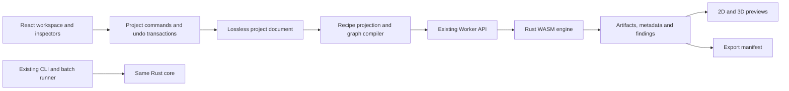

# M0 — Stencil Studio workflow and UI architecture

Date: 29 October 2026. Decision scope: architecture only. No redesigned screen or new processing operation is implemented in M0.

## Product workflow

Start with a large drop area and a Choose image action, plus a secondary Create text action. Import shows the original and a useful default style. **Make Stencil** runs the full-quality recipe and opens a clear preview with a readiness verdict. After the first full run, edits can show automatic drafts, but export always refers to an identified completed full-quality generation. A draft has a visible label and never replaces the last verified artifact invisibly.

The header holds the editable project name, New, Open, Save, Undo/Redo and Export. The workspace is mostly preview. Its top edge has Original / Stencil / 3D and fit/zoom; its footer shows real dimensions and readiness. A right inspector contains compact groups: Style and Detail, Paint selection, Size and strength, then Make Stencil and All Settings. The export action is also available in the header. Avoid duplicated floating toolbars. Under 900 px the inspector becomes a bottom region with the same reading order; full previews stay usable at 800 px and smaller.

Proposed styles are Standard, Smooth Vector and Crisp Raster, compiled from existing operations. Exact preset values must be tested against a representative image corpus before choosing product defaults; they are not invented engine parameters. Preserve the six original templates as named recipes in All Settings. Template-specific defaults and engine defaults remain distinct.

## Main controls and honest semantics

| Control | Engine routing / behavior |
|---|---|
| Choose / replace image | Original byte asset + `source.image_id`; no upload to a server |
| Make Stencil | Compile recipe and request full run, then validate matching generation |
| Style | Selects a declared raster/vector recipe; cannot silently overwrite an imported custom recipe |
| Detail | `source.resolution` for raster and `vector_stencil.detail` for vector; show which is adjusted and keep working resolution in All Settings |
| Paint / contrast preview | Automatic/manual `threshold.threshold`, invert and explanatory preview; no separate contrast slider until a real contrast operation is implemented |
| Automatic threshold + manual override | `256` means automatic; manual slider 0–255; preserve manual value when auto is toggled |
| Invert | `threshold.invert` in simple recipes; choose named pass/source for multi-colour workflows |
| Width | Active stencil `width_mm` or tile-layout `width_mm`; explain effective margin and height derived from aspect ratio |
| Thickness | Stencil `thickness_mm`; show measured final height including quantized and extra layers |
| Island protection / bridge width | Builders always bridge material islands; display protection status and `bridge_mm`; do not offer a fake off switch. `raised_bridges` is a separate geometry setting. Post-solid split has a real `bridge_islands` option with warnings. |
| Preview | Original bytes, paint mask or actual geometry view clearly named; 3D uses existing STL viewer |
| Readiness | Existing ready/check/blocked findings plus draft/stale/running state; actionable plain-English errors |
| Export | Final STL or selected parts ZIP; separately labelled Traced outlines SVG; save-project export always available |

The default 2D stencil view must be honest about whether it shows paint selection, the first physical layer or the top layer. Raised bridges change material with Z. Preserve mask and outline previews immediately; a bridge-corrected 2D display can be rendered orthographically from actual geometry with a selected layer. Do not advertise a corrected stencil SVG until an exporter derives and validates that geometry. The current trace SVG is useful and remains available with its accurate name.

## All Settings navigation

One searchable inspector, with categories ordered by usefulness rather than by code module. The selected colour/pass or product stays visible in its heading.

1. Artwork: file information, working resolution, text, crop/rotate/flip, smoothing, specks/holes, trace and corner cleanup.
2. Size and print: physical width, margins, orientation, base thickness, layer height and extra layers.
3. Bridges: count/position/spread, raised/easy/stepped geometry, contact strength, small-island removal, first-layer reinforcement and overhang checks.
4. Colours: reduction, separate colour passes, per-tone patterns, registration holes and alignment pins.
5. Mesh: curve detail, remesh interval, smoothing, material/deviation limits, decimation and measured before/after results.
6. Tiles: layout-before-build or split-finished-volume, bed limits, seam/connector editor, pockets, clearances, cut method, bevels, fragments and quality comparison.
7. Mounting and border: pads, wall holes, joiners/extenders, expanded rings, slabs, numbering and outer mounting.
8. Hardware: screw sizes, bolt/nut fit, manual plates and connector calibration strip.
9. Processing steps: ordered named steps, branch/pass selectors, insert/reorder/copy/duplicate; explicit valid input choices.
10. Presets and history: original templates, saved configurations, import/export and history navigation.
11. Batch and diagnostics: folder queue, parameter sweeps, reports, output manifest, timings, logs, worker/thread status and build versions.
12. Compatibility: preserved legacy operations, unknown values/types, migration report, original project download and unsupported capability explanations.

Fields show units next to numeric inputs, exact bounds, a concise explanation and reset. Conditional controls keep their values, remain searchable and show their enabling setting. Do not infer behavior from parameter names alone: overhang 0 differs between operations, `min_area` uses different units, and clearances can be radial or diametral. Search metadata must use qualified parameter keys and current scope.

## Internal architecture

Retain the Rust core, catalogue, CLI and WASM binding. Keep one shared React/TypeScript application and the existing Worker transport. Remove ReactFlow components from the user-facing app only after parity tests demonstrate that the new adapters emit equivalent graph JSON. Core computation still uses its typed graph, cache, targets and progress callbacks. There is no reason to rewrite geometry to deliver this UI.

Create independent frontend layers:

- `ProjectDocument`: lossless persisted envelope, original graph/image payloads, normalized asset references, named products/passes and application view state. Preserve unknown JSON keys and original bytes. Keep execution state and artifacts outside undo snapshots.
- `RecipeAdapter`: typed read/write projection for source, preparation, mask/trace, build and manufacturing steps. IDs are stable. Input references can express sharing and branching without a diagram. New recipes compile deterministically; imported projects receive minimal patches rather than being rebuilt from a template.
- `ParameterRegistry`: engine catalogue + interface mapping + qualified conditional help. Runtime schema remains authoritative for defaults, limits, choices and units; version the snapshot to detect drift. Render all unmapped known fields in a discoverable compatibility inspector during development, failing parity checks if this fallback is used at release.
- `ProjectCommands`: one transaction for crop gestures, preset application, shared-fit edits, source replacement, layout edits and structure changes. Preserve 100-step undo/history behavior initially; never record transient progress or camera motion as a geometry edit.
- `RunController`: monotonically increasing generation IDs, dirty/full/draft states, worker restart/asset restoration, target evaluation and throttled intermediate metadata. Ignore results from superseded generations. Reuse the existing cache and 150 ms draft / 350 ms settled behavior as a starting point, with measured changes only.
- `ArtifactRepository`: typed artifact keys, original assets, MIME, individual parts, availability and validation facts. Revoke old blob URLs; avoid regenerating STLs solely to re-render controls.
- `ExportPlanner`: selected plate/colour products plus auxiliary hardware outputs, filenames, quantities, physical dimensions, warnings and source generation. Detect collisions. Hardware currently returns only its own files; collect both branches explicitly. Keep originals and intermediate outlines as separate export choices.
- `PlatformAdapter`: browser file inputs/downloads and local worker queue; optional desktop filesystem/native batch process adapter behind the same interfaces. No remote services or accounts.

The new project envelope must include a legacy-compatible `graph` and `images` payload so the existing CLI continues to run it, or provide an explicitly labelled legacy export. Proposed metadata gets a new `studio` namespace; do not change version 2 serialization semantics without version detection and round-trip fixtures. The raw graph remains the authoritative compatibility representation until every recipe operation is covered.

## Complex workflows

**Colour plates:** colour tabs show palette swatches, labels and enabled passes. Each has its own ordered preparation/build steps; shared artwork and plate size are visible shared settings. Split produces ten masks; registered sets accept six solids. Keep all ten passes, permit separate sets/outputs, and explain the six-plate limit instead of dropping four. Tone patterns have a compact global section and per-tone overrides with inheritance. Registration requires equal measured XY sizes and a margin large enough for the hole. Preserve flipped-plate registration geometry.

**Tiles before building:** the tile planner consumes the active raster mask or vector shapes. It owns effective plate width and margin. Its preview exposes real engine seams/pockets/costs; drag and numeric/keyboard editing use the same constraints and offsets as `layoutEdit.ts`. Changing width/bed size retains offsets and reports ignored edits. It produces parts, so the UI cannot promise downstream solid-only remesh or registered colour sets on that output. Vector cut-whole is a distinct slower option; show warnings when fragments are dropped.

**Split a finished plate:** preserve as a separate strategy for remeshed solid outputs, bevels and legacy behavior. Provide bridge repair, seam gap, reinforcement and fragment removal as explicit steps. Do not silently switch users to tile-first. Compare material loss and seam-step metrics, and show actual affected artwork.

**Mounting and hardware:** a dedicated configuration page combines part preview with margin, pad/thread/hole, border slab and bolt/nut groups. Explain minimum margins and connector height before a full run. Use original engine validation as the final authority. Shared bolt fit settings affect new edits project-wide; unequal imported values are preserved until the user elects to link them. Parts table includes printable quantities, assembly role and all generated files.

**Arbitrary imported projects:** show a named product/pass outline and ordered processing lists, with plain-language input selectors for shared or multiple sources. Retain the original graph, ids, edges, parameters, embedded images, UI positions and unknown properties in memory and on disk, even though positions/wires are never shown. Recognized fields can be edited in place. Unknown operations are listed as preserved unavailable processing steps; execution/export is blocked when their outputs are required, with original-file download still available. Cycles or invalid dependencies receive actionable diagnostics. Open/import must not run a template, delete disabled/unused passes, clamp stored values, or discard unsupported objects. Engine evaluation may clamp a copy while stored input remains intact; disclose effective values. Migration of `complexity` to `remesh` is explicit and reversible in the import report.

## Light/dark and accessibility

Use system UI fonts already available offline, normal weights and a restrained spacing scale (4/8/12/16/24/32 px). Light: white surfaces, near-black text, neutral borders. Dark: near-black surfaces, off-white text, slightly lighter inspector. No gradients or decorative cards. Use a single neutral primary action; semantic error/warning colours are purposeful and paired with text. Existing 3D/layout colours remain meaningful view overlays with legends.

Respect system colour scheme on first run and save an explicit user preference. Both themes need contrast checks, visible keyboard focus, disabled-state readability and reduced-motion support. Use labelled tabs, headings and fieldsets; drawers/dialogs trap focus and restore it on close. Announce concise run status and error summaries without streaming every progress line into screen-reader alerts. All slider actions have numeric alternatives; seam/pocket edits need keyboard and numeric equivalents. Support Ctrl/Cmd+O/S/Z/Shift+Z, Ctrl+Enter to make, Ctrl+K search and Escape one level at a time without hijacking typing. Do not claim an axe scan alone establishes accessibility.

## Offline packaging decision

Recommended first delivery: shared React/WASM app plus the existing embedded localhost server/launcher. It already supports relative assets, correct WASM MIME and isolation headers, and works around `file://` restrictions. Package the built site with local launchers; no CDN fonts, scripts, telemetry or network processing. There is no existing service worker or installable PWA; browser-cache persistence alone is not an offline distribution strategy.

Evaluate Tauri 2 in a later isolated packaging spike **before choosing it**: worker loading, WASM compilation, atomics/shared-memory startup, single-thread fallback, WebGL, original asset persistence, STL/ZIP downloads, file dialogs and cancellation must pass on WebView2 and macOS WKWebView. Official Tauri configuration exposes isolation headers, but documentation is not runtime proof: [security headers](https://v2.tauri.app/reference/config/#headerconfig). Windows fully offline WebView2 bundling can add roughly 127 MB for the offline installer or 180 MB for a fixed runtime, conflicting with a 20 MB ZIP target: [installation modes](https://v2.tauri.app/reference/config/#webviewinstallmode). Prefer the local-browser fallback when runtime bundling or webview compatibility breaks offline/size requirements. Do not promise an offline clean Windows install merely because WebView2 already exists on the development machine.

Measure compressed deliverables per platform, including both engines and notices. Existing release sizes are baseline evidence, not predictions for the redesigned app. macOS signing/notarization, Windows signing/SmartScreen, Intel/ARM support and fresh-user offline launch remain release checks. Keep the CLI available for automation and scripting regardless of desktop choice.

## Implementation gates after M0

M1 should begin with the project/recipe adapter, lossless import fixtures, catalogue registry and main workflow shell while retaining the engine baseline. It requires the user's next milestone instructions. Later gates are all-parameter inspector wiring, complex workflow editors, platform packaging and cross-platform release validation. No release or parity claim is justified until PC-1/UI-1, legacy round trips, exported geometry validation, both WASM modes, offline fresh launch, keyboard/theming and real platform tests pass.

Adapter parity tests should compare compiled graph semantics and canonical geometry/metadata, ignoring only documented timestamps, durations and triangle ordering. M0 observed different STL byte ordering for geometrically identical runs, so a raw file hash is not a sufficient equivalence oracle. Preserve raw original image bytes exactly; do not apply geometry normalization to project assets. Add explicit fixtures for all recorded baseline defects and distinguish a UI regression from a defect already present in the pinned engine.
