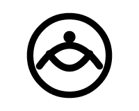
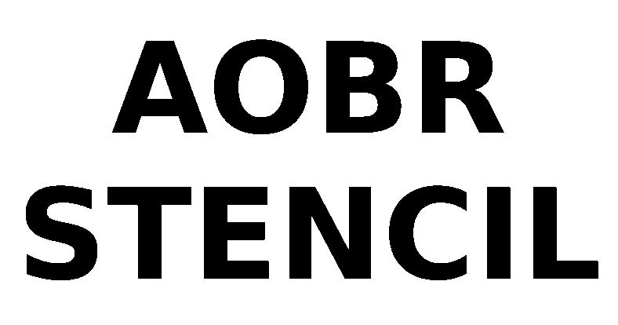
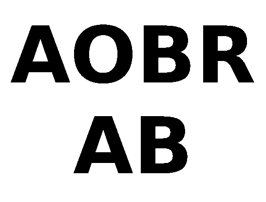
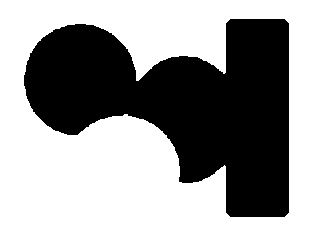
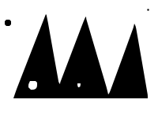
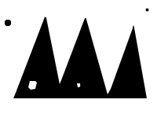

# Actual before/after preparation results

These files were emitted by the Rust engine through WebAssembly. They show artwork before physical stencil bridges. Each row uses a suitable focused fixture; it is not a comparison of one universal recipe.

| Operation and change | Before | After |
|---|---|---|
| `source.image_id` → "two" |  |  |
| `text.text` → "AOBR\nAB" |  |  |
| `transform.crop_left` → 12 |  |  |
| `threshold.threshold` → 180 |  |  |
| `reduce.colours` → 5 |  |  |
| `smooth.radius` → 0.25 |  |  |
| `morphology.op` → "dilate" |  |  |
| `trace.smooth` → 0 |  |  |
| `round_corners.max_angle` → 140 |  |  |
| `remove_islands.delete_specks` → false |  |  |
| `shapes_to_mask.resolution` → 300 |  |  |

## Openable demonstrations

Download [text-project.json](examples/text-project.json) or [long-chain-project.json](examples/long-chain-project.json), then choose Open Project in Stencil Studio. The complete saved preparation is retained. The text demo also has an independently validated [STL](examples/text-stencil.stl) and [pre-bridge traced SVG](examples/text-outlines.svg).
